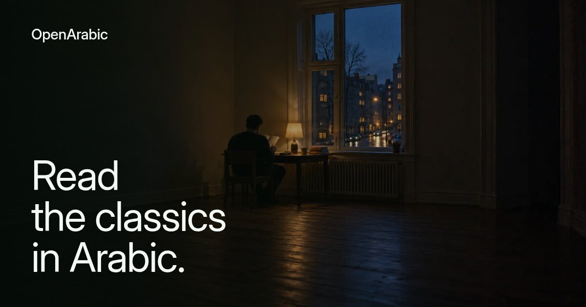
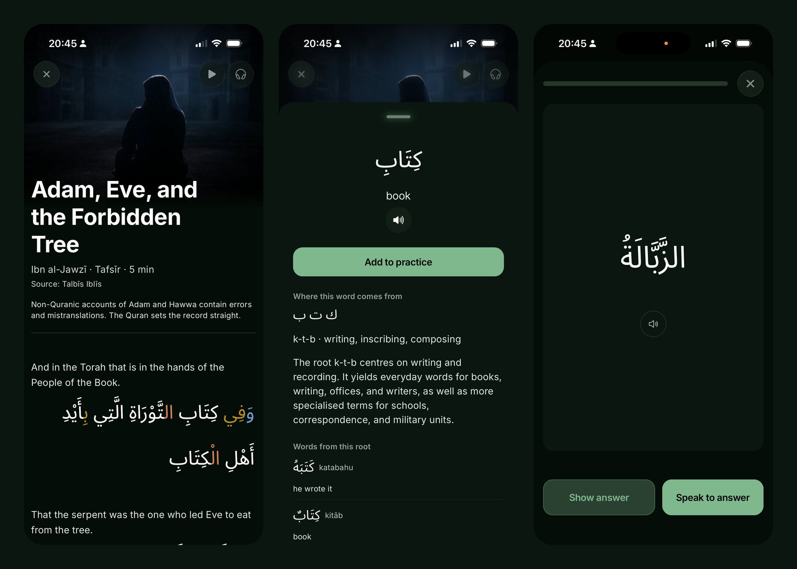
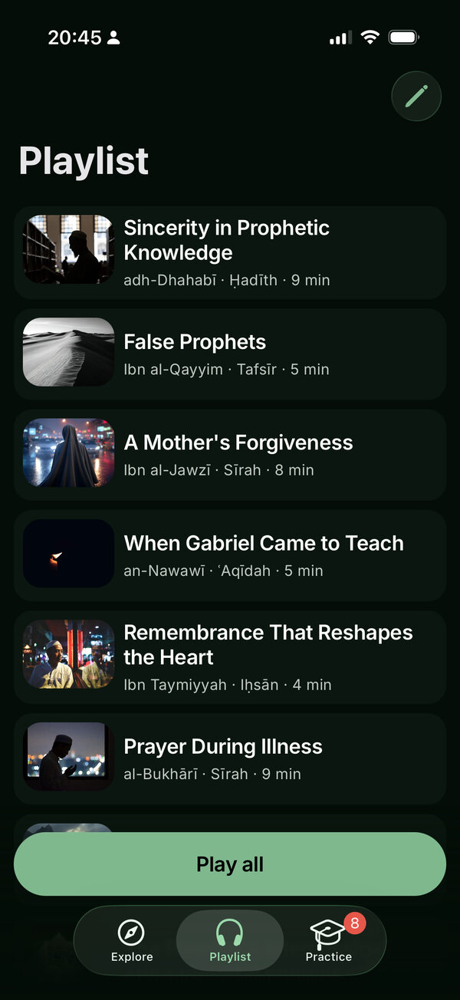
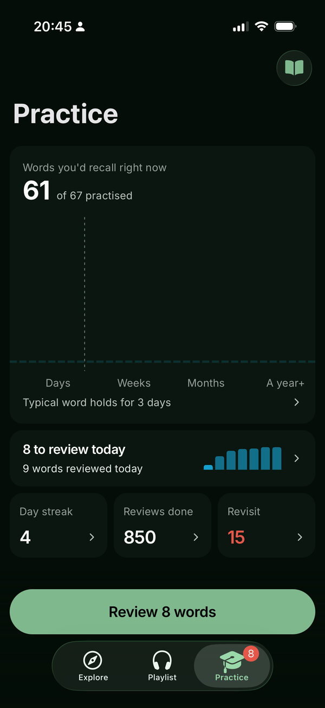
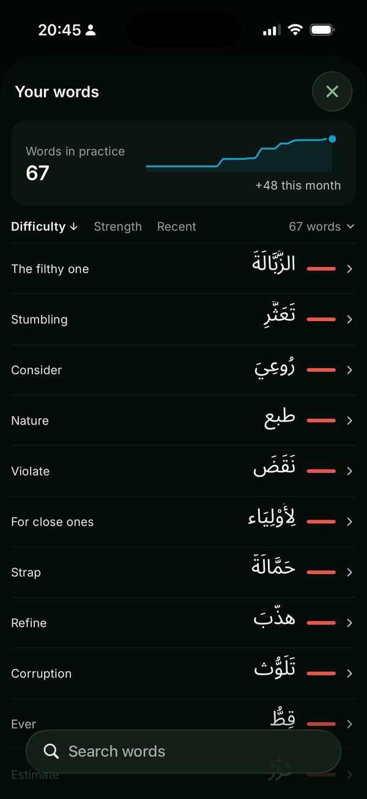

<p align="center">
  <a href="https://openarabic.io">
    
  </a>
</p>

<p align="center">
  An Expo app on Supabase for reading classical Arabic with English above every line,<br>
  with FSRS reviews and speech recognition that runs on the phone.
</p>

<p align="center">
  <a href="https://openarabic.io"><b>openarabic.io</b></a> ·
  <a href="https://apps.apple.com/app/openarabic/id1594031029">App Store</a> ·
  <a href="https://play.google.com/store/apps/details?id=com.edenmind.OpenArabic">Google Play</a> ·
  <a href="#development">Development</a> ·
  <a href="#layout">Layout</a>
</p>

<p align="center">
  <a href="https://github.com/YunusAndreasson/openarabic/actions/workflows/verify.yml"></a>
  <a href="https://apps.apple.com/app/openarabic/id1594031029"></a>
  <a href="https://play.google.com/store/apps/details?id=com.edenmind.OpenArabic"></a>
  <a href="LICENSE"></a>
</p>

<br>



## What it is

If you can sound out Arabic script, you can start reading classical texts. The
app holds excerpts from works by Ibn al-Jawzī, Ibn al-Qayyim, an-Nawawī, Ibn
Taymiyyah, al-Bukhārī and adh-Dhahabī, sorted by difficulty. Most are advanced;
some are easier. Nothing in it teaches the script. It's free, with no ads and no
subscription, and an account is needed to use it.

## Features

- **Read.** English above every Arabic line, so you can follow a text you
  couldn't yet read alone. The English is machine-translated. Colour shows how
  multi-part words are built, in any of five Arabic typefaces.
- **Tap a word.** One tap gives you the meaning, a grammar note and audio, and
  for most words the root and other words built on it, so a word you don't
  know costs a tap instead of a trip to the dictionary. Long-press saves it to
  Practice.
- **Practice.** Saved words come back when your predicted recall falls to 90%,
  scheduled with FSRS. You recall the meaning before the app shows it.
- **Speak to answer.** Hear the Arabic, then say what it means in English, and
  the app grades the answer. A 100 MB model transcribes your voice on the
  phone and the audio is never uploaded; the text of your answer is saved. It
  listens for English, so your Arabic pronunciation isn't graded.
- **Playlist.** Arabic audio on every word and every line, from AI voices. A
  queued text plays English first, then Arabic, or Arabic only.

<table>
  <tr>
    <td width="33%"></td>
    <td width="33%"></td>
    <td width="33%"></td>
  </tr>
  <tr>
    <td align="center"><sub><b>Playlist</b>, texts in a queue</sub></td>
    <td align="center"><sub><b>Practice</b>, how long words hold</sub></td>
    <td align="center"><sub><b>Your words</b>, hardest first</sub></td>
  </tr>
</table>

## Development

You need Node 22.13+, 24.3+ or 26+, and Yarn 4, which Corepack installs from
`packageManager`. Corepack ships with Node 22 and 24; on 26 it's a separate npm
package.

```sh
corepack enable
yarn install --immutable
yarn verify
```

`yarn verify` is what CI runs: TypeScript for the app and the tests, ESLint, a
deprecated-API check, knip and the Jest suite. Jest mocks Supabase, so it needs
no account or keys. While you work, `yarn validate` checks only the files
you've changed.

The app doesn't run in Expo Go. It needs a
[development build](https://docs.expo.dev/develop/development-builds/introduction/),
and it reads the production database with the public key in
[`constants/supabase.ts`](constants/supabase.ts). [AGENTS.md](AGENTS.md) has the
conventions, and [CONTRIBUTING.md](CONTRIBUTING.md) what a pull request needs.

## Layout

The app is the repository root. The other directories are separate projects
that share its Supabase database:

```
app/ components/ hooks/ services/   the Expo app
admin-dashboard/                    Next.js admin panel, not deployed
translate/                          Python pipeline: translation, vowel marks, audio
supabase/migrations/                schema changes to the shared database
social/ publish/                    word-of-the-day cards and the poster
brand/ store-listing/               the app mark and the store images
```

The website at openarabic.io is its own repository,
[openarabic-web](https://github.com/YunusAndreasson/openarabic-web).

## Docs

- [Design system](docs/DESIGN_SYSTEM.md): colour, type, motion and components
- [Grammar colour](.claude/docs/arabic-grammar.md): which parts get which colour
- [State](.claude/docs/state-management.md): Redux, TanStack Query or Context
- [Releases](.claude/docs/deployment.md): EAS builds, store submission, OTA
  updates
- [Testing](.claude/docs/testing.md)

## Under the hood

- [Expo](https://expo.dev) SDK 58 and [React Native](https://reactnative.dev)
  0.88, with [Expo Router](https://docs.expo.dev/router/introduction/) and the
  React Compiler
- [Supabase](https://supabase.com) for accounts and the database
- [Redux Toolkit](https://redux-toolkit.js.org) and
  [TanStack Query](https://tanstack.com/query) for state
- [ts-fsrs](https://github.com/open-spaced-repetition/ts-fsrs) for review
  scheduling
- [sherpa-onnx](https://github.com/k2-fsa/sherpa-onnx) running NVIDIA's
  Parakeet TDT 110M for speech recognition, and
  [ExecuTorch](https://github.com/software-mansion/react-native-executorch) for
  voice activity detection
- [Skia](https://shopify.github.io/react-native-skia/),
  [Reanimated](https://docs.swmansion.com/react-native-reanimated/) and
  [FlashList](https://shopify.github.io/flash-list/) for drawing and lists
- [Sentry](https://sentry.io) for crash reports, and Mixpanel and the Meta SDK
  for analytics

## License

The code is [MIT](LICENSE). The texts, translations, photographs and the
OpenArabic name and mark aren't; [NOTICE.md](NOTICE.md) lists them and their
terms.
